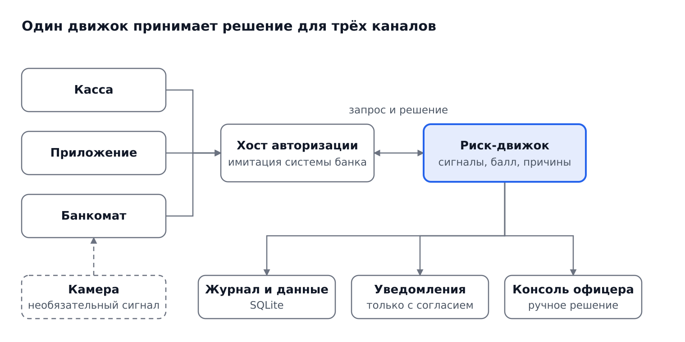

# Cash Shield (Sabyr)

Entry for the V ITU Hackathon-2026 (Bank CenterCredit case "Innovations and cybersecurity in banking").

**All data is synthetic and invented by the team.** The numbers show that the mechanism works without overfitting to individual examples. They do not show what would happen with real customers.

## 1. The problem

A scammer on the phone talks a customer into taking a loan, withdrawing cash or moving money to a "safe account". The customer does it personally, so the bank sees ordinary operations. Digital antifraud watches transfers, not the person at the ATM or the cash desk.

## 2. What it does

One risk engine on bank signals serves three channels: ATM, cash desk and mobile app.



| Score | Decision | What the customer sees |
|---|---|---|
| 0-39 | allow | nothing |
| 40-54 | ask | one question: "Is someone asking you by phone to withdraw or transfer this money?" |
| 55-84 | pause | pause screen (30 min), bank callback through the app, teller prompt at the desk |
| 85+ | hold | held until a bank officer decides |

- A trusted person gets a message only if the customer agreed beforehand. The message has no amount and no details.
- The answer "yes" always pauses. A coached victim learns to answer "no", so pausing does not depend only on the answer (see metric 2).
- The camera (phone at the ear) is an optional signal worth +10 points. Without it, recall drops by 1.7 points.
- Age is **not** a signal.
- Only the bank's authorization host can stop a withdrawal. In this demo the host is mocked (`/mock-host/authorize`).
- If the engine does not answer within 500 ms the host approves and logs it (fail-open: a fault in our service never blocks cash).

Signals (weights tuned on the tuning set, then frozen):

| Code | Signal | Weight |
|---|---|---:|
| S1 | Loan issued < 24 h ago | 30 |
| S2 | >= 80% of the balance moved out within 24 h | 20 |
| S3 | Cash >= 300 000 and >= 5x the customer's median | 15 |
| S4 | 2+ withdrawals in 24 h totalling >= 1 000 000 | 30 |
| S5 | Transfer >= 200 000 to a new recipient | 15 |
| S6 | Deposit closed early < 24 h ago | 20 |
| S7 | S5 and S6 together | 20 |
| S8 | Customer pressed "Scammer on the line" < 24 h ago | 40 |
| S9 | Recipient is a company | -15 |
| S10 | Camera: phone at the ear > 3 s (optional) | 10 |
| S11 | Escalation: customer answered "no", then tries again | 20 |

Every non-allow decision returns its reasons (`text_en`, `text_ru`), and a test enforces that.

## 3. Run it

Requires Docker.

```bash
cp .env.example .env
docker compose up --build
```

Then open <http://localhost:8080>:

| Screen | Address |
|---|---|
| ATM | `http://localhost:8080/#atm` |
| Cash desk | `http://localhost:8080/#desk` |
| Mobile app | `http://localhost:8080/#app` |
| Officer console | `http://localhost:8080/#officer` |

Without Docker (Windows, Python 3.11, Node 22):

```bash
python -m venv .venv
.venv/Scripts/pip install -r requirements-dev.txt
.venv/Scripts/python -m uvicorn services.api.main:app --port 8000
cd web && npm install && npm run dev      # http://localhost:5173
```

`make` is not used because the team develops on Windows. `python tasks.py <task>` replaces it:

| Command | What it does |
|---|---|
| `python tasks.py data` | Regenerate the scenario sets (fixed seeds, byte-identical) |
| `python tasks.py test` | Engine unit tests with coverage |
| `python tasks.py test-integration` | API endpoint tests |
| `python tasks.py eval` | **Metrics on the frozen holdout** (hash-checked); writes `reports/scorecard.md` |
| `python tasks.py eval --set tune` | Same on the tuning set |
| `python tasks.py tune` | Grid and coordinate search on the tuning set only |
| `python tasks.py bench` | 1000 authorize calls, latency |
| `python tasks.py demo-check` | Automated API-level rehearsal of the demo (10 runs) |
| `python tasks.py redteam` | Scripted red team, writes `reports/redteam.md` |
| `python tasks.py usability` | Scores the pause-screen usability test from `reports/usability_data.csv` (protocol: `docs/usability-test.md`) |

Demo customers: Gulnar apa (loan 3 h ago), Marat (control), Aigerim (deposit closed 1 h ago), Serik (buying a car), Bolat (cash desk), Dana. The **Reset demo** button in the officer console restores them.

Demo: the 3-minute script is in `docs/demo-script.md`. A silent, captioned backup walkthrough built from real screenshots of the running app is `pitch/demo-backup.mp4` (about 70 seconds; rebuild with `python pitch/make_video.py`). It is a walkthrough, not a screen recording with narration.

## 4. Metrics (holdout, measured once)

Holdout: 60 fraud and 120 normal synthetic scenarios, SHA-256 `6cf7a7134c02f3dc54333eedc01342310c4564bacd262f22a1b75fa8f5e99941`.
Thresholds were frozen (tag `thresholds-frozen`) before the measurement; see `reports/FREEZE.md`. Every holdout run is logged in `reports/holdout_runs.log`. Re-running `python tasks.py eval` reproduces the numbers.

| # | Metric | Actual | Target | Minimum | vs minimum |
|---|---|---|---|---|---|
| 1 | Recall (fraud scenarios stopped) | 78.3% (95% interval 66-87%) | >= 85% | >= 75% | PASS, target missed |
| 2 | Recall without relying on the question | 66.7% | >= 70% | >= 60% | PASS, target missed |
| 3 | False interventions on normal scenarios | 4.2% | <= 5% | <= 10% | PASS |
| 4 | False pauses | 0.0% | <= 1% | <= 3% | PASS |
| 5 | Pause precision | 100% (on a 33% fraud sample; real precision would be lower) | >= 95% | >= 90% | PASS |
| 6 | Money saved | 71.5% | >= 70% | >= 55% | PASS |
| 7 | Recall drop without camera | 1.7 pp | <= 3 pp | <= 5 pp | PASS |
| 8 | Evasion recall (split, headset, video) | 78.6% (14 scenarios) | >= 85% | >= 75% | PASS, target missed |
| 9 | Latency p95 (in-process, 1000 calls) | about 10 ms | <= 300 ms | <= 500 ms | PASS |
| 10 | Explainability | 100% | 100% | 100% | PASS |
| 11 | Fairness gap by age group | 8.3 pp | <= 5 pp | <= 8 pp | **FAIL** |

Not measured: camera accuracy (no camera model in this build), demo reliability, usability, red team. Do not read them as passed.

On fairness: the engine does not use age. The 5 false interventions were 3 among 36 normal scenarios aged 35-54, 2 among 61 aged 55+, and 0 among 23 aged 18-34. With groups this small, one scenario moves a group by 3-4 points, so the gap may be noise, but it is not proven to be. It is reported as a FAIL.

## 5. Data

Everything is generated by `data/generate.py`; the distributions are invented by the team.

- Tune: seed 42, 270 scenarios (180 normal, 90 fraud). Holdout: seed 2026, 180 scenarios (120 normal, 60 fraud), with amounts shifted by +-30% and time gaps by +-50%.
- 8 normal types (5 deliberately hard, for example a pensioner withdrawing everything or an honest customer spending a fresh loan) and 7 fraud types (including split withdrawals, headset and video-call coaching).
- Assumptions: 70% of fraud victims lie to the question; 15% of fraud scenarios include a prior "Scammer on the line" report.
- The same author wrote the rules and both sets. The holdout protects against tuning to individual examples, not against a shared mental model of how scammers behave.

## 6. Known limits

- **A single large cash-desk withdrawal after a loan** is caught only when the victim answers honestly or the amount is a large share of the balance. A combination signal for this (S12) made things worse and was reverted, because honest "spend a fresh loan" customers look the same. See `reports/negative_results.md`.
- **Red team (scripted, not blind; `reports/redteam.md`): 4 of 10 attempts moved 2 million or more without a stop.** All four were transfers or slow drips: a 2.2M transfer to an already-known recipient, a 2.2M transfer to a company (the company discount cancels the new-recipient signal), three 700k transfers to three companies, and one 400k withdrawal per day for six days. The six cash attempts made in a short burst (attempts 1-5 and 9) were all stopped, but five of them lost 500 000 to 1 000 000 before the stop (the one that waited 25 hours lost 1 000 000). These were not fixed by tuning after the measurement.
- **Own savings, no loan** is the weakest type (1 of 8 stopped).
- Video-call coaching is stopped only through the question (3 of 4), never by pause alone.
- Metrics come from synthetic scenarios of one team. They do not say how much a real bank would save.
- No legal point is confirmed by a lawyer: holding a customer's own money for 30 minutes, notifying a third party, using a camera. The pause length is configurable (`PAUSE_MINUTES`, including 0).
- Kazakh and Russian texts (KZ and RU buttons) were written by the team and need a native-speaker review. The screens are English, Kazakh and Russian; the officer console and risk reasons are English (reasons also carry a Russian copy).
- Telegram is simulated unless `TELEGRAM_BOT_TOKEN` and a chat ID are set; the real bot is untested.
- There is no phone-at-ear camera in this build. The ATM screen has a switch that simulates the signal.
- Officer login is a header (`X-Officer-Id`) in the demo, not real authentication.

## 7. Where a real bank plugs in

| Bank system | What we need | How the demo imitates it |
|---|---|---|
| ATM and card authorization host | Call the engine before answering; support a "hold" status | `/mock-host/authorize` |
| Core banking | Balance, loan and deposit events, transaction history | SQLite tables, seeded customers |
| Mobile app | Show the question and the pause screen; consent settings | The "Mobile app" screen |
| Teller workstation | Show the prompt while issuing cash | The "Cash desk" screen |
| Contact centre | Callback to the customer | A note on the pause screen |
| National Bank Antifraud Centre | Flag for a recipient in the scammer database | Not used as a signal in the MVP |

## 8. Roadmap and the ask

We cannot test on live ATMs after a hackathon and do not ask for it. Realistic steps:

1. **History check (about 4 weeks):** run the engine over de-identified confirmed cases and normal operations in a secure bank environment. Customers see nothing. Success: recall and false-alarm rate on real data, against a threshold the bank sets.
2. **Shadow mode (6-8 weeks):** live operations of one channel, decisions only logged. Success: how many later-confirmed cases the engine flagged early, and how many pauses a day officers would have to review.

Questions and pauses reach real customers only after both. The timelines are our estimates; the bank will name its own. The ask for the hackathon is a test environment and a few hours with the bank's antifraud team.

Not in this build: the camera signal as a real detector, Qaqpan (a button plus a wave radar), Kepil (staged-payment escrow).

## 9. Repository map

```
engine/       risk engine (signals.py, scoring.py, rules.yaml frozen, rules.start.yaml pinned for unit tests)
services/api  FastAPI: mock authorization host, decisions, consents, event log
web/          React screens: ATM, cash desk, app, officer console
data/         generator and the two scenario sets (holdout hash in HOLDOUT.sha256)
eval/         evaluate.py, tune.py, bench.py
reports/      scorecard.md, tuning.md, FREEZE.md, negative_results.md, holdout_runs.log
docs/         api.md, architecture image
```

## 10. Changes after the freeze

Packaging and evidence only (Docker files, README, `bench.py`, `test-integration` task, `redteam.py` and its log, `demo_check.py`, demo script and backup video). No change to weights, thresholds, scenarios or engine code. Any bug fix after the single holdout measurement must be listed here with its reason.
